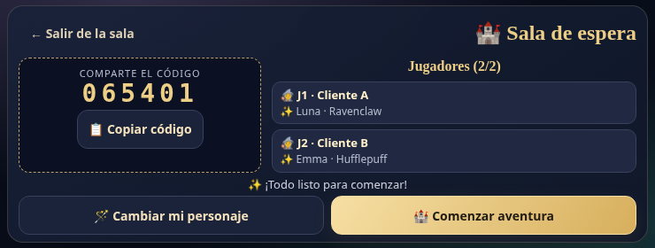
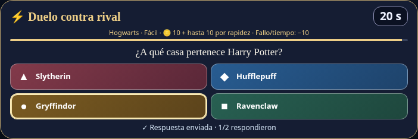
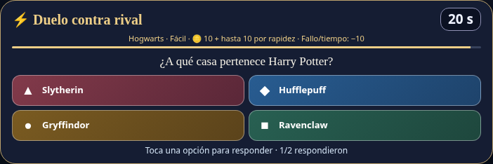
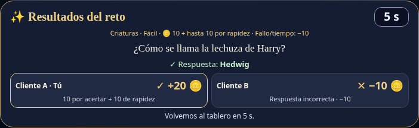
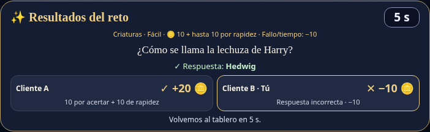

# Informe final: conexión en red de Hogwarts Party

**Fase 3 · Implementación y producto final**\
**Revisión del informe:** 13 de noviembre de 2026 · Sin portada\
**Código del juego evaluado:** `f5eabc2` · **Rama:** `codex/mobile-visual-improvements`

## Resumen

Hogwarts Party es un videojuego web de tablero para dos participantes que comparten una sala por Internet. Esta fase integra la creación de salas, selección de personajes, turnos, retos simultáneos, compras y resultados mediante una arquitectura cliente-servidor. React presenta la interfaz y un servidor Node.js valida las acciones y conserva el estado de la partida. Socket.IO transporta las solicitudes y distribuye las actualizaciones. El informe explica las decisiones técnicas, relaciona el código con los requisitos y presenta evidencias verificables. Se documentan 56 pruebas de lógica y 38 de navegador ejecutadas el 11 de noviembre, además de nueve comprobaciones de red realizadas el 13 de noviembre. También se identifican límites de persistencia, disponibilidad y medición del desempeño, junto con mejoras futuras.

**Contenido:** 1. Introducción; 2. Objetivos y requisitos; 3. Tecnologías; 4. Arquitectura; 5. Implementación; 6. Funcionamiento; 7. Metodología; 8. Casos y evidencias; 9. Resultados y desempeño; 10. Problemas y soluciones; 11. Limitaciones y mejoras; 12. Conclusiones; Referencias y anexos.

## 1. Introducción y planteamiento del problema

La conexión en red convierte una partida local en una experiencia compartida entre navegadores independientes. El problema principal consiste en mantener una única versión válida del juego: ambos participantes deben observar el mismo turno, resultado del dado, reto y saldo de monedas. Si cada navegador decidiera esos valores por separado, podrían aparecer movimientos distintos, premios duplicados o respuestas aceptadas después del límite de tiempo.

La solución implementada concentra las decisiones en un servidor. Cada cliente solicita acciones y representa el estado recibido. El servidor comprueba quién actúa, si pertenece a la sala y si la acción corresponde al momento actual. Después comunica el resultado a los integrantes de esa sala. Esta organización permite demostrar interacción real entre jugadores y revisar las reglas desde el código.

El proyecto utiliza un tablero ilustrado en dos dimensiones con 36 casillas. Combina preguntas individuales, duelos de respuesta simultánea, memoria, sorpresas y recursos visuales breves. Incluye un rival automático para jugar sin otra persona, pero la evidencia principal de conexión en red corresponde a dos clientes que participan en una misma sala.

El cliente se publica en <https://videojuego3d.netlify.app/> y el servidor en <https://hogwarts-party-2.onrender.com/>. El código está en <https://github.com/ahtziriHuerta/hogwarts-party-2>. Para evaluar esta entrega se debe consultar la rama indicada al inicio: la publicación en línea y `main` pueden corresponder a otra revisión. El nombre del dominio no significa que el juego sea tridimensional.

## 2. Objetivos, alcance y requisitos

### 2.1 Objetivo general

Implementar y verificar una conexión en red que permita a dos jugadores participar en una misma partida de Hogwarts Party, con reglas y resultados controlados por el servidor y una interfaz utilizable desde computadora o navegador móvil.

### 2.2 Objetivos específicos

1. Crear y unir salas mediante un código, manteniendo separados los estados de distintas partidas.
2. Sincronizar personajes, turnos, movimientos, monedas, inventario y resultados.
3. Validar las acciones en el servidor para rechazar turnos incorrectos, respuestas repetidas y datos inválidos.
4. Resolver retos con un plazo común y proteger las respuestas individuales mientras el duelo siga abierto.
5. Manejar esperas, errores de conexión, cancelaciones y desconexiones de forma explícita.
6. Documentar la estructura del código, ejecutar pruebas reproducibles y delimitar lo que sus resultados permiten concluir.

### 2.3 Requisitos y alcance de la entrega

| ID | Requisito | Criterio de aceptación |
| --- | --- | --- |
| RF1 | Crear y unir una sala. | Dos clientes ingresan con el mismo código y reciben ambos participantes. |
| RF2 | Preparar e iniciar la partida. | Personajes válidos; solo el creador inicia con dos participantes preparados. |
| RF3 | Compartir el tablero y los turnos. | Un lanzamiento válido produce el mismo dado y estado en ambos clientes. |
| RF4 | Resolver retos individuales y duelos. | El servidor acepta una respuesta por participante, controla el plazo y calcula el resultado. |
| RF5 | Gestionar monedas, objetos y victoria. | Compras sujetas a saldo e inventario; victoria al reunir dos trofeos. |
| RF6 | Tratar interrupciones. | Se informa la espera y se limpia el estado al cancelar, reiniciar o desconectar. |
| RNF1 | Mantener consistencia. | Ningún cliente puede proponer directamente el dado, premio o saldo válido. |
| RNF2 | Adaptar la presentación. | Tablero, formularios y retos utilizables en los tamaños emulados documentados. |
| RNF3 | Facilitar revisión y reproducción. | Código modular, comandos, pruebas y evidencias localizables. |

El alcance incluye partidas de dos participantes, ocho personajes, tablero, tienda, retos y modo contra bot. No incluye cuentas, guardado permanente, recuperación de una partida tras desconexión, chat ni alojamiento distribuido entre varias instancias. Estas exclusiones permiten valorar el producto actual sin atribuirle funciones todavía pendientes.

## 3. Tecnologías y decisiones técnicas

| Elemento | Tecnología | Motivo de uso en el proyecto |
| --- | --- | --- |
| Interfaz | React 19, JavaScript y CSS | Representar pantallas, formularios, tablero e inventario a partir del estado recibido. |
| Gráficos y recursos | SVG y MP4 breves | Mantener recursos ligeros y reproducibles desde el navegador. |
| Compilación | Vite 8 | Desarrollar el cliente y generar archivos estáticos para publicación. |
| Servidor | Node.js y Express 5 | Recibir conexiones y ejecutar reglas y temporizadores en un mismo proceso. |
| Comunicación | Socket.IO 4.8 | Organizar salas, eventos, acuses y reconexión del transporte. |
| Alojamiento | Netlify y Render | Separar la entrega del cliente estático de la ejecución continua del servidor. |
| Verificación | Node Test Runner, Playwright y Oxlint | Probar reglas, interacción de navegador y calidad estática. |

React facilita una interfaz declarativa: al recibir otra sala, la aplicación actualiza lo visible [1]. No se emplea un motor de física porque el producto consiste en un tablero por turnos con preguntas y animaciones SVG. La consigna recomienda motores y frameworks, pero no exige uno específico. La elección se justifica por lo que el juego necesita, sin afirmar que React sea un motor de videojuegos.

Se eligió una arquitectura cliente-servidor porque el turno y las recompensas requieren una autoridad común. Socket.IO añade eventos con nombre, agrupación por salas y acuses sobre sus transportes [2]. Puede iniciar mediante sondeo HTTP prolongado y actualizar a WebSocket; no es una conexión entre pares ni utiliza exclusivamente WebSocket. En la comprobación adicional se observó el transporte `websocket` en ambos clientes.

En producción los proveedores reciben conexiones HTTPS. Cuando Socket.IO utiliza WebSocket sobre esa conexión segura, el transporte es WSS. El proceso Node escucha HTTP detrás de la infraestructura del proveedor. Separar ambos niveles evita confundir la configuración interna del servidor con la conexión segura que utiliza el navegador.

## 4. Arquitectura y modelo del estado


**Figura 1.** Dos navegadores se conectan al mismo servidor. Netlify entrega archivos; Render ejecuta la lógica de la partida. Los clientes no se envían acciones directamente.

### 4.1 Distribución de responsabilidades

El navegador recoge nombres, selección de personaje, respuestas y compras. También dibuja el tablero y reproduce el recurso del reto activo. El servidor conserva las salas en un `Map`, identifica conexiones, valida acciones y distribuye una vista pública. Los recursos estáticos del reto se descargan desde el cliente publicado; el servidor transmite sus referencias y controla las fases, sin retransmitir el archivo de video a cada jugador por Socket.IO.

Una sala contiene `code`, `status`, `mode`, `players` y `game`. Cada participante tiene un identificador de conexión, nombre y personaje. La partida añade posiciones, monedas —representadas internamente como `points`—, trofeos, inventario, turno, dado, ganador y reto activo. El reto mantiene su identificador, participantes, fase, opciones, plazos y respuestas internas.

| Estado de sala | Significado y transición |
| --- | --- |
| `waiting` | Falta un participante. Al incorporarse el segundo, pasa a `ready`. |
| `ready` | Hay dos participantes. Todavía deben elegir personaje; el creador solicita el inicio. |
| `playing` | Partida activa. Se alternan movimientos y retos. |
| `finished` | Se cumple la condición de victoria; el creador puede solicitar reinicio. |

`ready` no garantiza por sí solo que ambos personajes estén elegidos: `start-game` comprueba ese requisito nuevamente. Ante una desconexión en multijugador, la sala vuelve a `waiting` y su partida se elimina. Las fases del reto son independientes: puede haber carga, reproducción o memorización, después respuesta y finalmente resultados.

### 4.2 Información compartida y privada

`publicRoom` selecciona los campos que reciben los clientes; `publicChallenge` filtra los datos del reto. Mientras se puede responder, se publica quién ya contestó, pero no su opción ni la solución. Al cerrar el reto se revelan los resultados. Las opciones descartadas por una pista se entregan en el acuse privado del usuario que la activa.

Esta separación reduce la información anticipada que viaja durante la partida. El banco de preguntas sí forma parte del código fuente entregado para revisión; por tanto, no se pretende mantenerlo secreto frente a quien tenga acceso al repositorio. Tampoco existe autenticación de cuentas: la pertenencia se vincula a la conexión y al código de sala.

## 5. Implementación de la conexión en red

### 5.1 Conexión y espera del servidor

El cliente de `src/socket.js` utiliza `autoConnect: false`, un tiempo de 65 segundos por intento, `tryAllTransports: true` y reintentos separados por entre 1,5 y 5 segundos. `src/roomConnection.js` coordina la solicitud de creación o ingreso: informa la espera, permite cancelar y conserva el intento de conexión hasta 90 segundos. Al conectarse envía la solicitud una sola vez y espera hasta 15 segundos su acuse.

Estos límites corresponden a etapas diferentes: los 90 segundos cubren la conexión y los 15 segundos posteriores cubren la respuesta a la solicitud. La instancia gratuita puede tardar en iniciar después de inactividad; el manejo de espera evita abandonar inmediatamente el intento, pero no garantiza la disponibilidad del proveedor. Cancelar retira los escuchadores y evita que una respuesta tardía cambie una pantalla que el usuario ya abandonó.

### 5.2 Creación de sala e identificación del jugador

`generateCode()` genera tres bytes aleatorios, los convierte en seis caracteres hexadecimales y repite si el código ya existe. `join-room` valida el código, la disponibilidad y el máximo de dos integrantes. Cada socket se incorpora a la sala de Socket.IO y guarda su código en `socket.data.roomCode`.

La comprobación de pertenencia se realiza en el servidor mediante este fragmento real de `server/index.cjs`:

```javascript
function getPlayerRoom(socket) {
  const room = rooms.get(socket.data.roomCode);
  if (!room) return null;
  if (!room.players.some((p) => p.id === socket.id)) {
    return null;
  }
  return room;
}
```

Así, una solicitud de movimiento no se autoriza porque el navegador declare un nombre de jugador. Se comprueba que la conexión que envía la acción pertenezca a la sala. Este control no sustituye un sistema de cuentas ni controles de abuso más amplios.

### 5.3 Eventos y acuses

| Solicitud | Datos principales | Validación o efecto |
| --- | --- | --- |
| `create-room` / `join-room` | `nickname`; al ingresar, `code` | Crear o localizar una sala y comprobar disponibilidad. |
| `select-character` | `character.id` | Usar el catálogo del servidor y evitar personajes ocupados. |
| `start-game` | Sin estado propuesto | Verificar creador, participantes y personajes. |
| `roll-dice` | Sin resultado propuesto | Validar turno, generar el dado y aplicar la casilla. |
| `answer-challenge` | `challengeId`, `answer` | Validar reto vigente, participante, fase, plazo y opción. |
| `challenge-media` | `challengeId`, `status` | Coordinar carga, reproducción o recurso alternativo. |
| `buy-spell` / `use-spell` | `spellId`; al usar, `challengeId` | Validar saldo, inventario y momento de activación. |
| `buy-trophy` / `restart-game` | Sin precio ni estado propuesto | Comprar según reglas o reiniciar con permiso del creador. |
| `create-solo-room` | `nickname`, `difficulty` | Crear una sala con un bot de dificultad válida. |

El acuse responde a una solicitud concreta con `ok` y, cuando procede, `error` u otros datos. `room-updated` informa el estado compartido a los miembros de la sala. Son mecanismos distintos: el primero permite saber si una acción fue aceptada y el segundo actualiza la representación común.

### 5.4 Autoridad del servidor y sincronización

Antes de lanzar, `rollDice()` comprueba que exista una partida activa, que no haya un reto pendiente y que el socket corresponda al jugador en turno. Genera el dado con `crypto.randomInt(1, 7)`, acumula pasos y calcula la posición sobre las 36 casillas. El cliente no envía el dado, el destino ni el premio que desea obtener.

Después de cambiar el estado se utiliza esta función real:

```javascript
function updateRoom(room) {
  bots.sync(room);
  io.to(room.code).emit("room-updated", publicRoom(room));
}
```

El envío se dirige a los integrantes de esa sala. Los clientes vuelven a representar el mismo estado autorizado. La llegada no tiene que ocurrir en el mismo milisegundo: la consistencia significa que ambos reciben las mismas decisiones, aunque el transporte y el navegador introduzcan diferencias de tiempo.

### 5.5 Retos, tiempos y prevención de respuestas repetidas

El plazo ordinario de respuesta es de 20 segundos y los resultados permanecen cinco segundos. La cuenta atrás del navegador es informativa; el servidor compara la hora de recepción con `deadlineAt`. También comprueba que el identificador sea el del reto activo, que la fase permita responder y que el jugador sea participante.

Este fragmento de `server/challenges.cjs` muestra el rechazo de una segunda respuesta y de opciones fuera de rango:

```javascript
if (challenge.responses.has(playerId))
  return { ok: false, error: "Ya enviaste tu respuesta." };
if (
  !Number.isInteger(data?.answer) ||
  data.answer < 0 ||
  data.answer >= challenge.options.length
) {
  return { ok: false, error: "Selecciona una respuesta válida." };
}
```

Las respuestas se guardan en el servidor. Al responder todos o agotarse el tiempo se calcula el resultado. En duelos, una respuesta incorrecta o ausente puede descontar hasta diez monedas sin dejar el saldo negativo; fallar un reto individual o de memoria no descuenta monedas. Una respuesta repetida no vuelve a conceder premios. Esta garantía corresponde al flujo de respuestas y no debe generalizarse a cualquier mensaje de compra.

Para recursos visuales hay una fase de carga limitada a diez segundos y una reproducción acotada a veinte. El reto de memoria incluye cinco segundos de observación. Reiniciar o desconectar cancela temporizadores para evitar que una tarea anterior modifique una partida nueva.

### 5.6 Organización del código

| Archivo o directorio | Responsabilidad para la revisión |
| --- | --- |
| `src/App.jsx`, `src/RoomLobby.jsx` | Navegación, solicitudes de sala y preparación de jugadores. |
| `src/socket.js`, `src/roomConnection.js` | Configuración de conexión, espera, cancelación y acuses. |
| `src/MagicBoard.jsx`, `src/LightningChallenge.jsx` | Tablero, inventario, respuestas y resultados visibles. |
| `server/index.cjs` | Salas, eventos, turnos, compras de trofeos y desconexión. |
| `server/challenges.cjs` | Fases, respuestas, plazos, premios y hechizos del reto. |
| `server/bot.cjs`, `memory.cjs`, `spells.cjs` | Rival automático, memoria y catálogo/reglas de objetos. |
| `shared/` | Catálogos compartidos del tablero, personajes y dificultades. |
| `tests/`, `docs/fase-3/` | Pruebas automatizadas, protocolo, evidencias y entregables. |

Los comentarios del código explican decisiones como el cálculo de pasos, la espera de Render y la privacidad de pistas. La documentación de eventos se amplía en `docs/fase-3/PROTOCOLO.md`. Esta separación facilita localizar cada procedimiento sin concentrar todas las reglas en componentes de interfaz.

### 5.7 Configuración de publicación y diagnóstico

Netlify compila el cliente con `npm run build` y publica la carpeta `dist`. Antes de compilar, `VITE_SERVER_URL` debe apuntar a la dirección HTTPS pública de Render. Las variables de Vite se incorporan al cliente durante la compilación: cambiar su valor requiere generar y publicar otra versión. Esta variable es una dirección pública de conexión, no una contraseña.

Render instala las dependencias y ejecuta `npm run server`; el servidor utiliza el puerto proporcionado por el entorno. La política de orígenes debe admitir el sitio de Netlify utilizado, incluidas las vistas previas autorizadas. Para probar desde otro teléfono se utiliza la dirección pública: `localhost` en ese teléfono designa al propio teléfono y no a la computadora del desarrollador.

Al diagnosticar un fallo conviene comprobar, en este orden, la dirección real del cliente, la URL del servidor incluida en la compilación, la disponibilidad y los registros de Render, y el error del transporte en el navegador. Así se distingue un servidor detenido o un origen rechazado de una validación del juego. Una pestaña abierta en la URL de una publicación antigua puede seguir mostrando esa revisión aunque se recargue.

## 6. Funcionamiento y uso del videojuego

Para jugar en red, una persona elige «Crear partida», escribe su nombre y comparte el código. La otra selecciona «Unirse a partida» e ingresa ese código. Ambas eligen personaje y el creador inicia la aventura. El jugador en turno lanza el dado; la casilla aplica su efecto o abre una actividad.

Los retos individuales involucran al jugador activo. Los duelos permiten responder a ambos dentro de un plazo común. Las casillas de memoria, bono, trampa y sorpresa aportan variedad. Las monedas permiten comprar objetos y trofeos; la condición de victoria es conseguir dos trofeos de cien monedas cada uno. Los objetos se compran en la tienda y se activan desde los controles del reto cuando cumplen sus condiciones; por ejemplo, el escudo se utiliza antes de responder un duelo y protege su penalización según las reglas.

El modo individual añade un rival automático con dificultad seleccionable. Utiliza reglas del servidor y puede equivocarse. Su existencia ayuda a practicar, pero una partida contra el bot no demuestra por sí sola la interacción entre dos personas conectadas.



**Figura 2.** Captura de un navegador conectado al servidor local durante la verificación del 13 de noviembre. Los nombres «Cliente A» y «Cliente B» identifican a los dos clientes de prueba.

## 7. Metodología de verificación

### 7.1 Procedimiento y entorno

La verificación combina pruebas de reglas sin navegador y pruebas de interacción con Chromium. Node Test Runner permite comprobar validaciones y estados [3]. Playwright ejecuta acciones y aserciones sobre la interfaz [4]. Oxlint revisa el código estáticamente y Vite comprueba que el cliente se pueda compilar [5]. Cada herramienta cubre un aspecto diferente; una compilación correcta no acredita por sí sola una partida funcional.

Se conservan dos registros separados. La batería completa del 11 de noviembre de 2026 utilizó Node `v24.22.1` y npm `11.9.0`, sobre el código `f5eabc233e2b17d74185c5899f99cf7c10ff5cc0`. La evidencia adicional del 13 de noviembre utiliza el mismo código del juego, con documentación incorporada en `da129ed`, y dos páginas Chromium con vista móvil horizontal de 740 × 280 píxeles. Las horas exactas en UTC están en los JSON de evidencias.

La prueba adicional usa sockets reales contra un servidor local en el puerto 3002 y Vite en el 5174. Precarga `tests/fixtures/fixed-dice.cjs` para obtener un recorrido repetible que llega a dos duelos. Este fixture solo se utiliza en pruebas; el servidor normal conserva el dado aleatorio. La automatización consulta el banco de preguntas para elegir respuestas correctas e incorrectas deliberadamente; esto permite verificar saldos conocidos y no representa una evaluación del conocimiento de jugadores humanos.

### 7.2 Cobertura y evidencia conservada

| Verificación | Resultado registrado | Archivo de evidencia |
| --- | --- | --- |
| Lógica y validaciones, 11/11 | 56 aprobadas; 0 fallidas. | `evidencias/unitarias.txt` y `resultados.json`. |
| Interfaz, 11/11 | 38 aprobadas; sin fallos, omisiones ni casos inestables registrados. | `evidencias/interfaz.txt` y `resultados.json`. |
| Análisis y compilación, 11/11 | Oxlint sin advertencias; compilación aprobada. | `evidencias/lint.txt`, `build.txt`. |
| Red con dos clientes, 13/11 | Nueve comprobaciones aprobadas; sin errores JavaScript de página. | `evidencias/red-adicional.json`, script y capturas. |

Las 56 pruebas de lógica incluyen 46 del servidor, seis de espera de conexión, dos de orígenes, una del tablero y una de recursos. Las 38 pruebas de navegador cubren conexión (3), duelo (1), horizontal (6), recursos visuales (5), vertical (5), pantallas previas (5), modo individual (6) y hechizos (7).

Las resoluciones horizontales emuladas incluyen 568 × 320, 667 × 375, 740 × 280, 844 × 390 y 932 × 430; las verticales incluyen 320 × 568, 360 × 640, 390 × 700, 412 × 823 y 430 × 932. Son pruebas de tamaño y comportamiento en Chromium: no equivalen a validación formal de un Galaxy físico, iOS o Safari. La espera de 55 segundos y algunos recorridos del bot se comprueban con reloj simulado; no son mediciones del despertar real de Render.

## 8. Casos de prueba de red y evidencias

Los casos C01–C09 se ejecutaron el 13 de noviembre como una secuencia adicional, conservada en `verificar-red.mjs`. Son nueve comprobaciones de ese procedimiento; se informan aparte de los 94 casos de la batería histórica.

### 8.1 Preparación, pertenencia y sincronización

**Precondiciones:** servidor de prueba y cliente en ejecución; dos páginas nuevas; sin una partida previa en esas páginas.

| Caso y acciones | Resultado esperado | Resultado obtenido |
| --- | --- | --- |
| C01. A crea sala; B ingresa con el código. | Ambos identifican la misma sala y sus dos participantes. | Aprobado. Código coincidente y dos participantes visibles. |
| C02. Tras elegir personajes e iniciar, B envía `roll-dice` durante el turno de A. | El servidor rechaza la solicitud. | Aprobado: «Todavía no es tu turno.». La solicitud se envía directamente para comprobar el servidor, aunque la interfaz ya bloquee el control. |
| C03. A realiza un lanzamiento válido. | Ambos reciben el mismo dado, identificador de reto y opciones. | Aprobado. Dado 3 con el fixture; mismo duelo y opciones en A y B. |

La validación de C02 demuestra por qué no basta con deshabilitar un botón: la regla también se impone cuando una solicitud llega directamente al servidor. C03 verifica una actualización producida por la misma acción, en lugar de comparar dos pantallas preparadas de forma independiente.

### 8.2 Privacidad y validación de respuestas

**Precondiciones:** primer duelo en fase de respuesta, con ambos participantes conectados. A contesta correctamente y B permanece pendiente.

| Caso y acciones | Resultado esperado | Resultado obtenido |
| --- | --- | --- |
| C04. Inspeccionar la actualización recibida por B después de responder A. | Se informa un participante respondido, sin solución anticipada. | Aprobado. Un identificador en `answeredPlayerIds`; sin campos `answer` ni `correctAnswer` en el reto público. |
| C05. A envía otra respuesta para el mismo reto. | Rechazo, sin segundo premio. | Aprobado: «Ya enviaste tu respuesta.». |
| C06. B envía el índice de opción 99. | Rechazo por opción fuera de rango. | Aprobado: «Selecciona una respuesta válida.». B puede después enviar su respuesta válida. |



**Figura 3.** Cliente A después de responder. El reto continúa abierto para el otro participante.



**Figura 4.** Cliente B en ese mismo reto. Se muestra el avance de respuestas sin revelar el acierto de A. Las figuras 3–6 recortan el cuadro del reto para facilitar su lectura; proceden de navegadores conectados al servidor local.

### 8.3 Resultados, penalización y desconexión

**Precondiciones:** ambos completan el primer duelo correctamente. Después del intervalo de resultados se inicia un segundo duelo; A responde bien y B responde mal deliberadamente.

| Caso y acciones | Resultado esperado | Resultado obtenido |
| --- | --- | --- |
| C07. Cerrar el primer duelo con ambos aciertos. | Los clientes reciben los mismos saldos y resultados correctos. | Aprobado. Saldos A = 20, B = 20 en ambos clientes. |
| C08. En el segundo duelo, A acierta y B falla con saldo suficiente. | A gana el premio; B pierde diez; los saldos coinciden en ambos clientes. | Aprobado. Cambios +20 y −10; saldos finales A = 40, B = 10. |
| C09. Cerrar la página de B durante la partida. | La sala de A vuelve a esperar y elimina la partida activa. | Aprobado. Un participante restante, `status: waiting` y `game: null`. |



**Figura 5.** El servidor asigna el premio de A y la penalización de B. Los valores corresponden al recorrido controlado de la prueba, no a todos los premios posibles del catálogo.



**Figura 6.** El otro cliente recibe los mismos resultados. La perspectiva del usuario cambia, pero la decisión y los saldos de la partida son comunes.

C09 confirma el comportamiento actual y documenta una limitación: el sistema puede reconectar el transporte, pero no restaura automáticamente la partida anterior. El registro JSON incluye los acuses, los estados públicos y los transportes observados; los identificadores de cliente se sustituyeron por `cliente-A` y `cliente-B` para facilitar su lectura.

## 9. Resultados, análisis y desempeño

### 9.1 Interpretación de los resultados funcionales

La batería histórica registra 94 casos aprobados: 56 de lógica y 38 de navegador. La verificación adicional registra nueve comprobaciones aprobadas y transporte WebSocket observado en ambos clientes. En conjunto, estas evidencias respaldan la creación e ingreso a salas, la validación de acciones y la distribución consistente del estado en los escenarios ensayados.

Los resultados no prueban ausencia total de errores ni estabilidad ante cualquier cantidad de jugadores. La batería de interfaz duró aproximadamente 342 segundos; ese valor corresponde al trabajo de automatización, no a un tiempo de respuesta del juego. La comprobación adicional funciona sobre la red local del entorno y no reemplaza una demostración desde dos dispositivos por Internet.

### 9.2 Observaciones de comunicación

La captura adicional mide desde el envío de una solicitud hasta su acuse usando el reloj del navegador. Se conservan muestras individuales, incluidas solicitudes rechazadas; no se descartan tiempos altos para mejorar los resultados.

<!-- METRICAS_RED_INICIO -->
| Solicitud | Muestras | Intervalo observado hasta el acuse |
| --- | --- | --- |
| `create-room` | 1 | 54,1 ms |
| `join-room` | 1 | 14,1 ms |
| `select-character` | 2 | 55,5–56,6 ms |
| `start-game` | 1 | 14,2 ms |
| `roll-dice` | 3 | 1,5–127,2 ms |
| `answer-challenge` | 6 | 0,9–29,5 ms |

En una difusión del primer duelo, la actualización se registró 104 ms después del envío en A y 2 ms después en B; la separación observada fue de 102 ms. Se trata de una sola difusión sobre loopback. Registro de ejecución: `2026-11-13T19:36:47.901Z`.
<!-- METRICAS_RED_FIN -->

Estas observaciones incluyen programación de eventos, ejecución del navegador, procesamiento del servidor y transporte local. No aíslan latencia de red ni tiempo de CPU del servidor. Son una muestra funcional pequeña, sin percentiles ni estimación de capacidad concurrente. La diferencia de llegada entre clientes demuestra que compartir un estado no significa dibujarlo en el mismo instante.

### 9.3 Tamaño de recursos y límites de la medición

| Recurso | Resultado de compilación o inventario del 11/11 |
| --- | --- |
| JavaScript generado | 317,19 kB; 99,47 kB con gzip. |
| CSS generado | 41,75 kB; 9,10 kB con gzip. |
| Recursos de preguntas visuales | 36.734 bytes en total: diez SVG y dos clips MP4 breves. |

Los recursos pequeños reducen datos transferidos y la espera potencial de carga. Esos tamaños corresponden a la compilación y al inventario, no a una descarga medida en todos los teléfonos. El cliente carga el recurso del reto activo; la lógica de carga y sustitución evita mantener una pregunta bloqueada indefinidamente si el recurso falla.

No se realizó ensayo formal de carga, medición de memoria del servidor, consumo de batería, latencia en redes móviles ni duración del inicio en frío real de Render. Para evaluar estabilidad a escala se necesitan sesiones concurrentes, registro de tiempos y recursos del proceso, además de pruebas prolongadas bajo condiciones controladas.

## 10. Problemas atendidos y soluciones implementadas

| Problema observado durante el desarrollo | Solución presente en el código | Comprobación y alcance |
| --- | --- | --- |
| Conexión desde Netlify y sus vistas previas. | Política de orígenes en el servidor y URL configurable mediante `VITE_SERVER_URL`. | Pruebas de orígenes y conexión. CORS no sustituye autenticación. |
| Abandono temprano ante un error inicial de transporte. | Espera global de conexión, aviso y cancelación con limpieza de escuchadores. | Pruebas de conexión y reloj simulado; no mide la disponibilidad real del proveedor. |
| Tablero y pantallas previas difíciles de utilizar en tamaños móviles. | Distribución adaptable y controles ajustados para vertical y horizontal. | Escenarios de navegador en los tamaños indicados; dispositivos físicos pendientes. |
| Diferencia de tiempos de carga en retos visuales. | Fases de carga y reproducción, límites y alternativa ante fallo. | Pruebas de recursos, fases y tiempos. |
| Dificultad para encontrar cómo usar objetos comprados. | Controles de inventario visibles antes de las respuestas cuando el objeto es aplicable. | Siete escenarios de hechizos en la batería de interfaz. |

Estas soluciones atienden problemas concretos. Por ejemplo, ampliar la espera no corrige una URL incorrecta ni un servidor detenido; por eso el informe distingue la configuración del despliegue, el transporte y las reglas del juego.

## 11. Limitaciones y mejoras futuras

| Prioridad | Mejora propuesta | Razón y forma de comprobarla |
| --- | --- | --- |
| Alta | Recuperación de sesión con identificador estable y plazo de regreso. | Evitar perder una partida por una interrupción breve. Probar caída, retorno, duplicación de sesión y vencimiento del plazo. |
| Alta | Persistencia de salas y estado con expiración. | Recuperar partidas después de reiniciar el proceso. Probar reinicio y limpieza de datos antiguos. |
| Alta | Validación en dispositivos y redes reales. | Confirmar controles táctiles, teclado, audio y video en Android/iOS. Medir una partida desde conexiones distintas. |
| Media | Pruebas de carga y observabilidad. | Medir latencia, errores y memoria con varias salas; establecer umbrales después de obtener una línea base. |
| Media | Límites de solicitudes y controles de abuso. | Reducir intentos masivos de ingreso o envío de acciones. Comprobar que los límites no bloqueen el uso normal. |
| Media | Escalamiento con estado compartido y adaptador de mensajería. | Admitir varias instancias; resolver también la afinidad de sesión según el transporte y alojamiento elegidos. |
| Baja | Actualizaciones parciales y accesibilidad ampliada. | Reducir mensajes si el estado crece y mejorar uso con teclado y lectores de pantalla; medir antes y después. |

Actualmente un reinicio del servidor elimina las salas porque viven en memoria de un único proceso. La reconexión de Socket.IO no basta para resolverlo: se necesita diseñar la identidad de sesión, restaurar el estado y decidir qué ocurre con los temporizadores. La prioridad debe ser conservar correctamente una partida antes de aumentar usuarios o añadir más actividades.

## 12. Conclusiones

La implementación resuelve el objetivo de interacción en red en los escenarios verificados: dos clientes se incorporan a una sala, comparten personajes y turno, participan en el mismo reto y reciben resultados consistentes. El modelo de autoridad del servidor permite rechazar solicitudes fuera de turno y respuestas repetidas o inválidas sin depender exclusivamente de los controles de interfaz.

La separación entre estado público e información interna evita revelar anticipadamente la solución y las respuestas individuales durante el duelo. Las pruebas de dos clientes muestran tanto coincidencia de resultados como diferencias temporales de recepción, lo que permite explicar de manera concreta la sincronización implementada.

Las pruebas y la compilación aportan evidencia reproducible para la entrega, con fechas y alcances explícitos. El producto conserva límites que deben explicarse durante la presentación: las partidas no son persistentes, una desconexión cancela la partida activa y el desempeño bajo carga no está medido. Las siguientes mejoras deben concentrarse en recuperación de sesión, persistencia y evaluación en dispositivos y redes reales.

## Referencias

1. React. *Documentación: descripción y actualización de la interfaz*. <https://react.dev/learn>.
2. Socket.IO. *Documentación 4.x: funcionamiento, salas y eventos*. <https://socket.io/docs/v4/>, <https://socket.io/docs/v4/rooms/> y <https://socket.io/docs/v4/emitting-events/>.
3. Node.js. *Test runner*. <https://nodejs.org/api/test.html>.
4. Playwright. *Writing tests*. <https://playwright.dev/docs/writing-tests>.
5. Vite. *Building for Production*. <https://vite.dev/guide/build.html>.
6. Consigna de la asignatura facilitada por la estudiante: *Fase 3: Implementación de la Conexión en Red, Entrega 3 — Producto Final*. Requisitos y criterios utilizados para organizar este informe.
7. Código fuente y evidencias del proyecto: <https://github.com/ahtziriHuerta/hogwarts-party-2/tree/codex/mobile-visual-improvements/docs/fase-3>. Revisiones completas registradas en los archivos JSON de evidencias.

## Anexo A. Reproducción de las verificaciones

Desde la carpeta del repositorio, con Node.js y npm instalados:

```bash
npm ci
npm test
npm run lint
npm run build
```

Para las pruebas de interfaz, instalar Chromium si no está disponible y ejecutar la configuración de Playwright del proyecto:

```bash
npx playwright install chromium
npm run test:ui
```

Para reproducir solamente C01–C09, abrir tres terminales en la raíz del repositorio. Los siguientes comandos utilizan la sintaxis de macOS/Linux. El fixture debe limitarse a este procedimiento de prueba.

**Terminal 1: servidor controlado.**

```bash
PORT=3002 node --require ./tests/fixtures/fixed-dice.cjs server/index.cjs
```

**Terminal 2: cliente de prueba.**

```bash
VITE_SERVER_URL=http://localhost:3002 npm run dev -- \
  --mode browser-tests --host 127.0.0.1 --port 5174 --strictPort
```

**Terminal 3: capturas y registro.**

```bash
node docs/fase-3/evidencias/verificar-red.mjs
```

Si se usa un Chromium del sistema, se puede indicar su ruta mediante `PLAYWRIGHT_CHROMIUM_EXECUTABLE_PATH`. El script regenera el JSON y cinco capturas; deben conservarse juntos al documentar otra ejecución. Los tiempos y premios pueden variar según el entorno, por lo que se debe consultar el registro de esa ejecución. Detener los dos servidores de prueba al terminar.

Para una partida manual normal se usan `npm run server` y, en otra terminal, `npm run dev`, con `VITE_SERVER_URL` apuntando al servidor correspondiente. No se precarga el fixture. Antes de exponer, comprobar la URL pública, abrir dos navegadores o dispositivos y realizar una partida desde la red del aula.

## Anexo B. Correspondencia con los criterios de evaluación

| Entregable o criterio de la consigna | Evidencia y ubicación | Situación |
| --- | --- | --- |
| Videojuego funcional con conexión en red. | Flujo de la sección 6; casos C01–C08; código cliente y servidor. | Implementado y verificado localmente en los escenarios descritos. |
| Código fuente actualizado y documentado. | Rama indicada, mapa de archivos de la sección 5.6, README y protocolo. | Código y documentación entregables desde el repositorio. |
| Explicación de la conexión en red. | Secciones 3–5: arquitectura, transportes, eventos, acuses y autoridad. | Incluida. |
| Pruebas realizadas y resultados. | Secciones 7–9, JSON, registros y figuras 2–6. | Incluidos con fecha y límites de cobertura. |
| Mejoras y optimizaciones futuras. | Sección 11, prioridades y forma de validación. | Incluidas como trabajo futuro, no como funciones ya implementadas. |
| Estabilidad y desempeño. | Rechazos, temporizadores, desconexión, tamaños de recursos y mediciones locales. | Evidencia funcional disponible; ensayo formal de carga pendiente. |
| Presentación clara y demostración efectiva. | `GUION_PRESENTACION.md`, diapositivas y recorrido con dos personas. | Material preparado; exposición y demostración ante la clase pendientes de realizar. |
