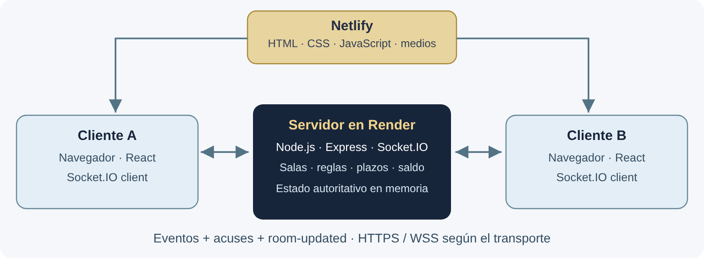

# Informe final: implementación de la conexión en red

**Proyecto:** Hogwarts Party · **Entrega:** Fase 3, producto final\
**Versión del juego revisada:** `f5eabc233e2b17d74185c5899f99cf7c10ff5cc0` · **Verificación:** 11 de noviembre de 2026 (UTC)

## 1. Objetivo y alcance

El objetivo de esta fase fue integrar la interacción en red entre jugadores en un videojuego funcional. Hogwarts Party es un juego web de tablero en dos dimensiones, por turnos, para dos personas conectadas a la misma sala. Incluye además un modo individual contra un rival automático. La demostración del requisito de red se realiza con dos clientes humanos; el bot es una función complementaria.

La aplicación ofrece un tablero de 36 casillas, ocho personajes, trivias individuales y simultáneas, memoria, sorpresas, imágenes y clips cortos. Los jugadores obtienen monedas y compran hechizos o trofeos. Gana quien consigue dos trofeos de 100 monedas. Los controles y el tablero se adaptan a pantallas verticales y horizontales.

El producto se consulta en <https://videojuego3d.netlify.app/>. El servidor está en <https://hogwarts-party-2.onrender.com/> y el código fuente en <https://github.com/ahtziriHuerta/hogwarts-party-2>, rama `codex/mobile-visual-improvements`. Se debe entregar esta rama o su archivo ZIP: la rama `main` puede no contener la misma versión.

## 2. Tecnologías y responsabilidades

| Componente | Tecnología | Responsabilidad |
| --- | --- | --- |
| Cliente web | React 19, JavaScript, CSS y SVG | Mostrar pantallas, recoger acciones, dibujar el tablero y reproducir el recurso del reto activo. |
| Compilación | Vite 8 | Preparar los archivos estáticos del navegador. |
| Servidor | Node.js y Express | Mantener salas y partidas en memoria y recibir conexiones. |
| Comunicación | Socket.IO 4.8 | Enviar eventos, acuses de recibo y actualizaciones a los participantes de una sala. |
| Publicación | Netlify y Render | Entregar el cliente estático y ejecutar el servidor respectivamente. |
| Verificación | Node Test Runner, Playwright y Oxlint | Comprobar reglas, conexión, interfaz y análisis estático. |

React gestiona una interfaz de tablero, preguntas y animaciones SVG. El requisito proporcionado recomienda motores o frameworks, pero no establece uno obligatorio. La tecnología de red implementada es Socket.IO, compatible con el uso de WebSockets mencionado en la consigna.

## 3. Arquitectura de la conexión



**Figura 1.** Cada navegador es un cliente independiente. Los jugadores no se conectan directamente entre sí. El servidor conserva el estado válido y distribuye una vista pública de la sala.

Socket.IO permite usar WebSocket y también sondeo HTTP prolongado como transporte alternativo. La conexión puede comenzar mediante sondeo y actualizarse a WebSocket. Por ello, no debe describirse como un protocolo que utiliza exclusivamente WebSocket ni como una conexión entre pares. En producción se utilizan las direcciones HTTPS de los proveedores; cuando se emplea WebSocket sobre esa conexión segura, el transporte es WSS. El servidor Node escucha HTTP detrás de la infraestructura de publicación.

En `src/socket.js` se configura el cliente, con 65 segundos por intento, reintentos y posibilidad de probar otro transporte. `src/roomConnection.js` conserva la solicitud de entrada hasta 90 segundos mientras se establece la conexión y muestra un aviso de espera. Una vez conectado, envía la solicitud una sola vez y espera su acuse hasta 15 segundos. El usuario puede cancelar. Esta espera contempla que la instancia gratuita de Render pueda tardar en iniciar; no elimina las interrupciones del proveedor.

## 4. Flujo de una partida compartida

1. El primer cliente envía `create-room` con su nombre. El servidor valida el dato, genera un código hexadecimal de seis caracteres y registra la sala.
2. El segundo cliente envía `join-room` con el código. El servidor comprueba que la sala exista, acepte jugadores y tenga espacio. Ambos quedan asociados a la sala de Socket.IO.
3. Cada cliente solicita `select-character`. El servidor obtiene la apariencia desde el catálogo compartido y evita que dos personas seleccionen el mismo personaje.
4. El creador solicita `start-game`. La partida solo inicia si hay dos participantes y ambos tienen personaje.
5. El jugador en turno solicita `roll-dice`. El servidor genera el resultado, mueve la ficha y aplica el efecto de la casilla o crea un reto.
6. Tras cada cambio válido se emite `room-updated` a la sala. Los dos clientes dibujan el mismo turno, posiciones, monedas, trofeos y fase del reto.
7. El servidor resuelve el reto, muestra los resultados durante cinco segundos y avanza el turno. También determina la victoria.

La actualización compartida se concentra en este procedimiento real del servidor:

```javascript
function updateRoom(room) {
  bots.sync(room);
  io.to(room.code).emit("room-updated", publicRoom(room));
}
```

El cliente solicita una acción, no un resultado. Por ejemplo, para lanzar el dado no envía la casilla de destino ni las monedas que desea obtener: esos valores se calculan en el servidor.

## 5. Eventos y datos intercambiados

| Evento del cliente | Datos principales | Validación o efecto del servidor |
| --- | --- | --- |
| `create-room` | `nickname` | Crea una sala compartida y responde con su código y estado. |
| `join-room` | `nickname`, `code` | Comprueba existencia, disponibilidad y máximo de dos participantes. |
| `select-character` | `character.id` | Usa el catálogo válido y comprueba ocupación. |
| `start-game` | Sin datos de juego | Solo el creador puede iniciar una sala preparada. |
| `roll-dice` | Sin resultado propuesto | Solo actúa el jugador en turno; se bloquea durante retos. |
| `answer-challenge` | `challengeId`, `answer` | Verifica participante, fase, plazo e índice; acepta una respuesta por jugador. |
| `challenge-media` | `challengeId`, `status` | Gestiona carga, reproducción y sustitución de un recurso fallido. |
| `buy-spell` / `use-spell` | `spellId`; al usar, también `challengeId` | Verifica saldo, inventario y reglas de activación. |
| `buy-trophy` | Sin precio propuesto | Descuenta 100 monedas y comprueba la victoria. |
| `restart-game` | Sin datos de juego | Solo el creador reinicia; cancela tareas y restablece el estado. |
| `create-solo-room` | `nickname`, `difficulty` | Crea una sala individual con un bot y dificultad válida. |

Las solicitudes responden mediante un acuse con `ok` y, si corresponde, `error` u otros datos. `room-updated` es el evento del servidor que sincroniza la sala. `connect`, `connect_error` y `disconnect` permiten tratar el ciclo de conexión.

La estructura de una sala incluye código, estado, modo, participantes y partida. La partida mantiene jugadores, turno, dado, ganador, contador de lanzamientos y reto activo. Los estados generales son `waiting`, `ready`, `playing` y `finished`. Los retos pueden pasar por `loading`, `watching` o `memorizing`, después `answering` y finalmente `results`.

## 6. Autoridad, privacidad y estabilidad

### 6.1 Reglas controladas por el servidor

La pertenencia se comprueba con `socket.id` y la sala asociada al socket. El servidor valida el turno y el rol del creador. También decide dados, preguntas, premios, penalizaciones, compras y resultados. Las monedas nunca bajan de cero. En duelos, fallar o agotar el plazo descuenta hasta diez; en individuales y memoria no se descuentan monedas por fallar.

El plazo de respuesta es de veinte segundos. El navegador dibuja la cuenta atrás, pero el servidor comprueba la hora real al recibir una respuesta. Un mensaje duplicado o tardío no puede sumar premios otra vez. Reiniciar o desconectar cancela los temporizadores del reto y del bot para que una tarea anterior no afecte a otra partida.

### 6.2 Información pública y privada

`publicRoom` y `publicChallenge` seleccionan qué información llega a los clientes. Antes de cerrar el reto se publica quién ya respondió, pero no su opción ni la solución. La solución y los resultados se envían en la fase de resultados. Una pista descarta dos opciones incorrectas únicamente mediante el acuse privado de quien la activa; los índices descartados no se incluyen en el estado compartido.

Los recursos y las preguntas del servidor forman parte del código fuente entregado para revisión. La separación anterior evita enviarlos anticipadamente al cliente durante la partida; no pretende ocultar el código a quien tiene acceso al repositorio.

### 6.3 Desconexión y restricciones actuales

La reconexión del transporte no equivale a recuperar una partida. Si una persona se desconecta, una sala compartida vuelve a esperar y pierde la partida activa. Una sala individual se elimina. Al reiniciar Render se pierden todas las salas, porque se mantienen en memoria de un solo proceso. No hay cuentas, persistencia ni restauración de sesión.

`server/origins.cjs` permite los dominios del proyecto y los orígenes locales configurados. CORS restringe el acceso desde navegadores, pero no sustituye la autenticación de usuarios. El alcance actual es una aplicación académica de salas temporales.

## 7. Organización del código y ejecución

| Ruta | Función |
| --- | --- |
| `src/App.jsx`, `src/socket.js`, `src/roomConnection.js` | Pantallas, conexión y entrada a salas. |
| `src/RoomLobby.jsx`, `src/CharacterSelection.jsx` | Preparación de los participantes y personajes. |
| `src/MagicBoard.jsx`, `src/LightningChallenge.jsx` | Tablero, controles, preguntas y resultados. |
| `src/SpellShop.jsx`, `src/ChallengeSpells.jsx`, `src/ChallengeMedia.jsx` | Compras, uso de hechizos y recursos del reto. |
| `server/index.cjs`, `server/challenges.cjs` | Estado autoritativo, salas, acciones, plazos y resultados. |
| `server/bot.cjs`, `server/spells.cjs`, `server/memory.cjs`, `server/surprises.cjs` | Reglas del rival y de las actividades. |
| `shared/` | Tablero, personajes, dificultades y catálogo de hechizos compartidos. |
| `tests/` | Pruebas de lógica, conexión e interfaz. |

Se requiere Node.js 22.12 o posterior; la verificación de esta entrega utiliza Node.js v24.22.1. Desde el repositorio se ejecuta `npm ci`. Después se abren dos terminales:

```sh
# Terminal 1: servidor, puerto 3001 por defecto
npm run server

# Terminal 2: interfaz de desarrollo
npm run dev -- --host 0.0.0.0
```

Para publicar, se define `VITE_SERVER_URL=https://hogwarts-party-2.onrender.com` antes de `npm run build`. Netlify sirve `dist/`; Render ejecuta `npm run server` y utiliza `PORT` cuando el proveedor lo establece. El README contiene el procedimiento para acceso desde un celular en la red local y la lista de orígenes permitidos.

## 8. Pruebas realizadas y resultados

### 8.1 Método y entorno

La verificación corresponde al commit indicado al principio, sin modificar las reglas de producción para la entrega. `npm test` ejecuta pruebas del servidor con transportes simulados y reloj controlado, además de pruebas de conexión, dominios, recorrido y recursos. Playwright inicia servidores locales reales en los puertos 3002 y 5174 y prueba la interfaz en Chromium. Sus casos compartidos utilizan dos páginas de navegador con conexiones independientes.

Solo en las pruebas de interfaz se precarga `tests/fixtures/fixed-dice.cjs` para reproducir un recorrido conocido. En producción el dado permanece aleatorio. Los escenarios de diseño de `tests/fixtures/` verifican vistas concretas, como la victoria y los tamaños del tablero; no equivalen a jugar una partida completa en cada resolución.

| Comprobación | Resultado de esta ejecución |
| --- | --- |
| `npm test` | 56 casos aprobados; 0 fallidos. |
| `npm run test:ui` | 38 casos aprobados; 0 fallidos; 0 omitidos. |
| `npm run lint` | Aprobado, sin advertencias. |
| `npm run build` | Aprobada. |

### 8.2 Cobertura y evidencia

| Área | Comprobación principal | Evidencia |
| --- | --- | --- |
| Salas y permisos | Validación de participantes, creador, personajes y acciones fuera de turno. | `tests/server.test.cjs`; pruebas de sala de Playwright. |
| Interacción compartida | Dos clientes ven el mismo reto y resultado; solo pueden enviar una respuesta. | `tests/browser/duel.spec.js`. |
| Plazos y privacidad | Rechazo de respuestas tardías; solución oculta y avance aunque no respondan. | Pruebas del servidor y caso compartido. |
| Tienda | Saldo e inventario válidos, escudo sin pérdida y pista privada. | Pruebas del servidor y `tests/browser/spells.spec.js`. |
| Preparación de medios | El reloj espera a carga y reproducción; un fallo usa una trivia de respaldo. | `tests/browser/media.spec.js` y servidor. |
| Conexión lenta | Espera simulada de 55 segundos, una solicitud y cancelación sin sala tardía. | `tests/browser/connection.spec.js`. |
| Modo individual | Dificultades, turnos del bot, compras y cancelación; victoria completa con reloj simulado. | Servidor y `tests/browser/solo.spec.js`. |
| Adaptación visual | Tamaños verticales y horizontales; giro conserva posición y respuesta. | Pruebas de diseño y selección. |

Se incluyen cinco tamaños horizontales —568×320, 667×375, 740×280, 844×390 y 932×430— y cinco verticales —320×568, 360×640, 390×700, 412×823 y 430×932— en el conjunto de pruebas. La espera de 55 segundos se simula con el reloj de Playwright: demuestra el comportamiento del cliente, no mide cuánto tarda realmente en despertar Render.

Las salidas y el resumen reproducible acompañan la entrega en `evidencias/`. La evidencia permite comprobar el resultado de los comandos; no garantiza ausencia de errores fuera de los casos cubiertos. Quedan pendientes pruebas formales en dispositivos físicos, Safari y redes del aula.

## 9. Desempeño y optimizaciones aplicadas

El catálogo visual contiene diez SVG y dos MP4 de seis segundos, con un total de **36734 bytes**. Solo se solicita el archivo del reto activo. El mapa y los personajes utilizan SVG locales. El bot funciona mediante reglas y temporizadores en Node.js, sin llamadas a un servicio de IA.

La compilación produjo aproximadamente **317.19 KB de JavaScript** y **41.75 KB de CSS**; sus tamaños gzip reportados por Vite fueron **99.47 KB** y **9.10 KB** respectivamente. Estas cifras describen archivos de esta compilación; no son una medición del consumo de memoria, los FPS ni la latencia del juego. No se realizó una prueba de carga ni se estableció un máximo de jugadores simultáneos.

La actualización actual envía una vista completa de la sala después de los cambios. Es una solución sencilla para partidas de dos participantes; para aumentar la escala será necesario medir y optimizar su frecuencia y tamaño.

## 10. Mejoras futuras y conclusión

| Prioridad | Mejora | Resultado esperado |
| --- | --- | --- |
| Alta | Recuperación de sesión con un identificador estable y plazo de reconexión. | Retomar una partida tras una interrupción breve. |
| Alta | Persistencia y limpieza por caducidad de salas. | Conservar partidas ante reinicios y controlar recursos. |
| Media | Medir latencia, tamaño de mensajes, memoria y carga concurrente. | Establecer límites de servicio con datos reales. |
| Media | Estado compartido y coordinación entre procesos si crece el servicio. | Ejecutar varias instancias sin perder coherencia entre salas. |
| Media | Actualizaciones parciales del estado y validación formal de esquemas. | Reducir tráfico y mejorar el tratamiento de mensajes inválidos. |
| Media | Verificación en dispositivos físicos, Safari y redes restringidas. | Ampliar la compatibilidad comprobada. |

El producto integra interacción en red mediante eventos y un estado autoritativo por sala. Las pruebas documentadas comprueban sincronización, plazos, privacidad, compras y adaptación visual dentro del alcance descrito. La siguiente prioridad técnica es recuperar sesiones y medir el desempeño bajo condiciones reales de uso. La presentación ante la clase debe mostrar dos clientes humanos, además de explicar estas limitaciones.

## Referencias y archivos de revisión

- Código de la versión revisada: <https://github.com/ahtziriHuerta/hogwarts-party-2/tree/f5eabc233e2b17d74185c5899f99cf7c10ff5cc0>.
- Socket.IO, descripción y transportes: <https://socket.io/docs/v4/>.
- Playwright, pruebas de navegador: <https://playwright.dev/docs/intro>.
- Node.js, ejecutor de pruebas: <https://nodejs.org/api/test.html>.
- Vite, compilación para producción: <https://vite.dev/guide/build.html>.
- Archivos clave: `server/index.cjs`, `server/challenges.cjs`, `src/socket.js`, `src/roomConnection.js`, `README.md` y `tests/`.
