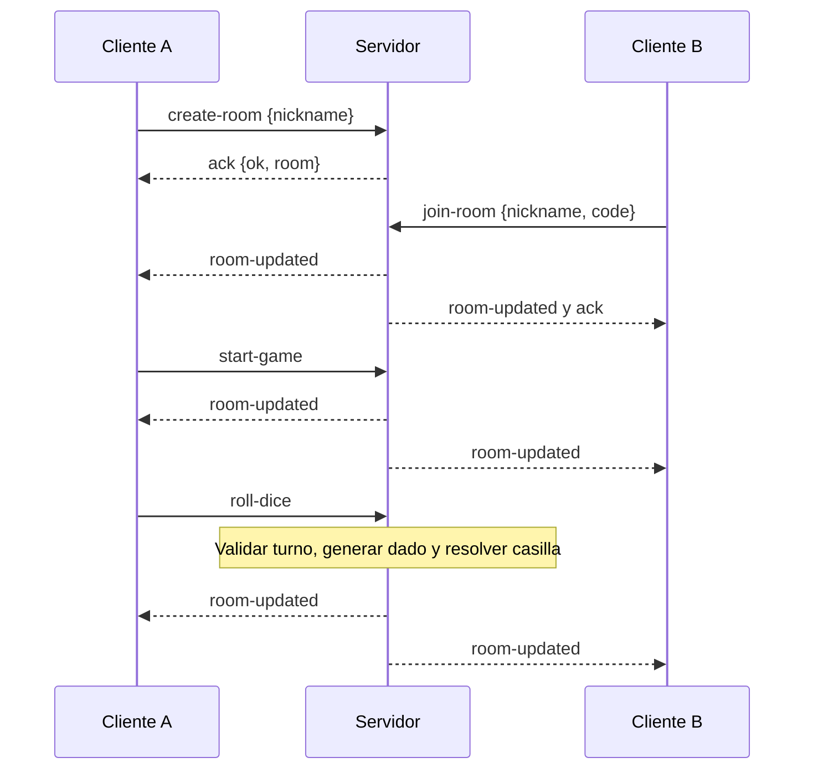

# Protocolo de red y guía de revisión del código

La descripción completa está en [el informe](INFORME_FINAL.md). Las rutas siguientes parten de la raíz del repositorio.

| Procedimiento | Archivo o función para revisar |
| --- | --- |
| Abrir la conexión y elegir transportes | `src/socket.js` |
| Esperar, enviar una sola entrada y cancelar | `requestRoom` en `src/roomConnection.js` |
| Asociar eventos a pantallas | `src/App.jsx` |
| Crear, unirse, seleccionar e iniciar | `io.on("connection")` en `server/index.cjs` |
| Validar pertenencia | `getPlayerRoom` en `server/index.cjs` |
| Generar el dado y mover | `rollDice` en `server/index.cjs` |
| Publicar estado limitado a una sala | `publicRoom` y `updateRoom` en `server/index.cjs` |
| Plazos, una respuesta y resultados | `answer`, `reveal` y `schedule` en `server/challenges.cjs` |
| Ocultar respuestas antes de resultados | `publicChallenge` en `server/challenges.cjs` |
| Pista privada y escudo | `useSpell` en `server/challenges.cjs` |
| Compras verificadas | `server/spells.cjs` y `buyTrophy` en `server/index.cjs` |
| Preparación de imagen y clip | `mediaStatus` en `server/challenges.cjs` |
| Rival automático | `server/bot.cjs` |
| Cancelar al cerrar la sesión | Handler `disconnect` en `server/index.cjs` |

## Ejemplo de secuencia

Cada selección de personaje ocurre antes de `start-game`, aunque se omite en el diagrama para resumir la secuencia. El servidor puede rechazar cualquier solicitud inválida mediante `ok: false` y `error`.

## Límites que deben explicarse

- El código de sala no es una cuenta de usuario ni una contraseña.
- CORS no sustituye la autenticación.
- El transporte puede reconectar, pero una partida desconectada no se restaura.
- Las salas no sobreviven a reiniciar el proceso de Render.
- No existe una medición formal de carga, latencia o capacidad concurrente.
